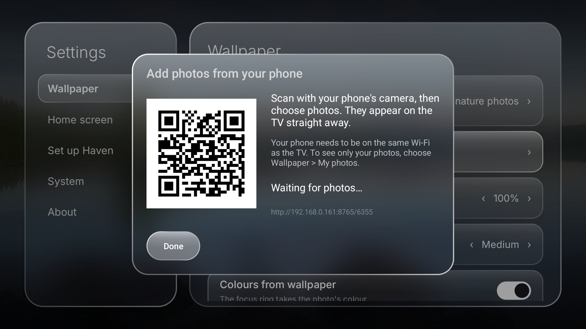

# Haven

A fast, minimal home screen for Google TV and Android TV, in the spirit of Apple TV: a clean row
layout, a dock of your favourite apps and a daily photo from the internet behind it.

No ads, no tracking, no account, no root. Written in plain Java with no libraries; the APK is
about 1.5 MB and Haven uses around 80 MB of memory on a 2.5 GB TV.


| | |
|---|---|
|  |  |
| *Continue watching, Top picks, Favourites* | *All apps, with glass tiles* |
|  |  |
| *Search: apps as you type, plus Google and YouTube search* | *A Projectivy wallpaper plugin (Photo of the Day)* |
|  |  |
| *Edit mode: hold OK, then move tiles with the arrows* | *Tile options: dock, folders, rename, hide* |
|  |  |
| *Haven Settings* | *Set up Haven: everything from the remote, no computer* |
|  | |
| *Add your own photos: scan the QR code with your phone* | |

## Features

- **Home**, top to bottom:
  - **Up next**: a glass card for what you were watching, with the season and episode, how far
    you got and Resume. It turns to your next in-progress title every 5 seconds (pausing
    while you use the remote); the ‹ › arrows (Left/Right) step through them yourself.
  - **Top picks for you**: a few programs from each app's home-screen channels, mixed so no
    single app takes over, plus what's popular on Netflix in your country, shown with a wide
    picture and the title's logo. Any app that publishes Android TV's standard rows shows up here
    and in Up next, in any country (Stremio, for example).
  - **Recent**: your recently used apps.
  - **Favourites**: the dock.
  - **Inputs**: Live TV and HDMI, with ports that have something plugged in first.
  - **Apps**: every app, which you can sort, put in folders, rename or hide.
  - Each row except Apps can be turned off in Haven Settings > Home screen.
- **Top bar** (press Up): account, search, Home, Live TV, Inputs, Free TV (the TV maker's free
  channels app by default; hold OK on it to open any app you like instead) and TV Settings.
- **Live TV** opens the HDMI port your set-top box is on: the one it finds over HDMI-CEC, else the
  only port with something connected, else the last port you used. Hold OK on Live TV to pick a
  port yourself or use the TV's own Live TV app (also in Haven Settings > Home screen).
- **Search**: a full-screen search bar that finds apps as you type, with "Search all your apps"
  (Google's search) and "Search YouTube". The mic types what you say into the search box.
- **Wallpapers**: Bing's photo of the day (the default) or Wikimedia's Picture of the Day, with
  the place and photographer shown in the corner. Photos come from the internet and aren't
  stored; only the last one is kept, small, for when the TV is offline. The photo blurs while you
  use the remote and turns sharp again when you stop. The focus colour comes from the photo.
- **Your own photos**, added without adb: scan a QR code on the TV with your phone and pick
  photos, or copy them from a USB drive. Choose Wallpaper > My photos to show them.
- **Wallpaper plugins**: Haven works with Projectivy Launcher's wallpaper plugins, such as
  Photo of the Day, Apple aerials, movie and show art (TMDB), Immich, Jellyfin and more.
  Install a plugin, then choose it in Haven Settings > Wallpaper. Its settings open from Haven
  Settings too. Still images, drawables and colours are supported; video and Lottie wallpapers
  aren't yet. Plugins that react to the focused card or to idle mode receive those events.
- **Icon packs**: TV banner packs such as the
  [Projectivy Icon Pack](https://github.com/SicMundus86/ProjectivyIconPack/releases) and
  [Core Builds](https://github.com/brevityA/CoreBuildsApps/releases) give every app a matching
  banner; square glyph packs sit on glass tiles. Choose one in Haven Settings > Home screen >
  Icon pack. Any standard (ADW/Nova/Lawnchair) pack works. Hold OK on an app to keep its own banner.
  The Projectivy Icon Pack is used by default when it's installed.
- **Clock, date and weather** for wherever the TV is (Open-Meteo; °F in the US).
- **Edit mode**: hold OK until the tiles wiggle, then move apps between the dock and the grid,
  make folders, rename or hide apps.
- **Screensaver**: "Haven wallpapers" shows your chosen wallpaper with a large clock.
- **Home button**: an accessibility service opens Haven straight away when you press Home, with no
  flash of the stock launcher. Google TV doesn't let a third-party launcher take over Home any
  other way.
- **Survives "cleaner" apps** (e.g. TCL's Safety Guard): it keeps a backup of your layout, starts
  its Home-button service again if something switches it off, and gets past boot managers that
  block third-party apps from starting at boot.
- **Glass look**, inspired by Apple's Liquid Glass: the top bar, tiles, cards, search, Settings and menus get a
  frosted fill that shows the blurred wallpaper behind, a light-catching rim and a soft sheen.
- **Springy focus**: tiles spring up when focused and bounce at the end of a row, so a press
  that has nowhere to go still answers.
- **Light on memory**: banners, icons and posters are kept at the size they're shown, and Haven
  lets go of its pictures while another app is in front, so the TV is less likely to close it.
- **Settings** in two panels (sections on the left, options on the right). Left/Right changes a
  value in place.
- **Updates itself**: Haven checks GitHub for new versions and installs them when you say so.
  Android asks you to confirm each one; nothing installs silently.
- Up/Down moves exactly one row and Left/Right stays inside the row, so the remote never jumps
  somewhere unexpected.

## Install

### Without a computer

1. On the TV, install **Downloader** (by AFTVnews) from the Play Store.
2. Open Downloader and enter this address:
   `https://github.com/joydeepsjce/haven-tv/releases/latest/download/haven.apk`
3. When Android asks, allow Downloader to install apps, then press **Install**.
4. Open **Haven** from your apps. It opens **Set up Haven**. Turn on each item with the remote:
   - **Home button**: on Android 14 and later, Android blocks the Home button for apps installed
     from a file (it switches itself off a second after you turn it on). Choose **Fix** once:
     Haven asks you to turn on the TV's *Network debugging* (Developer options), then uses it to
     unlock itself. Choose **Allow** (with *Always allow* ticked) when the TV asks
     "Allow USB debugging?". Afterwards you can turn debugging off again.
   - **Continue watching and Top picks**, and **Weather**: Android asks once. Choose Allow.
   - **Recent apps**: opens Usage access. Choose Haven and allow it.
   - **Install updates**: lets Haven install its own updates. You confirm each one.
   - **Keep the Home button on**: the same one-time step, if you haven't done it; Haven then turns
     the Home button back on whenever the TV or a cleaner app switches it off.
5. Press Home.

**Updating:** Haven Settings > About > Check for updates. Haven also checks by itself every
12 hours and tells you when there's a new version.

### With a computer (optional extras)

Not needed any more (Set up Haven does it with the TV's own debugging), but the script still works.
A one-time adb setup adds two things the remote can't: Haven turns its Home-button service back
on if a "cleaner" app (such as TCL's Safety Guard) switches it off, and system animations run
twice as fast. It also does everything in Set up Haven in one go.

1. On the TV, turn on **Developer options**: Settings > System > About, then press OK on
   *Android TV OS build* seven times. Then turn on **USB debugging** and **Network debugging**
   under Settings > System > Developer options. Note the TV's IP address (Settings > Network).
2. Run the setup script from this repo. Include `haven.apk` to install or update Haven too.
   The first time, the TV asks you to allow debugging from your computer.

   ```sh
   sh setup.sh 192.168.1.50 haven.apk
   ```
   On Windows:
   ```powershell
   powershell -ExecutionPolicy Bypass -File setup.ps1 -Tv 192.168.1.50 -Apk haven.apk
   ```

Turn off Network debugging afterwards if you like; Haven doesn't need it.

**Remove:** Haven Settings > System > **Uninstall Haven**. Haven first undoes what it changed
outside itself (its layout backup, the animation speed, its Home-button service), then Android
asks you to confirm. If you cancel, Haven puts everything back. From a computer:
`sh setup.sh <ip> --remove` (`setup.ps1 -Tv <ip> -Remove`).

## Permissions

| Permission | Why |
|---|---|
| Accessibility service "Haven Home button" | Opens Haven when you press Home. It only listens for the Home key and for the Google TV home screen opening. It can't read what's on screen and logs nothing. |
| `READ_TV_LISTINGS` | Reads the Continue watching and channel rows your apps publish, as the stock launcher does. |
| `WRITE_SECURE_SETTINGS` (computer setup only) | Starts the Home-button service again if something turns it off, sets animation speed to 0.5×, and keeps a backup of the layout (which apps are where, nothing personal). |
| Usage access | Lists recent apps in the Recent row, including ones not opened from Haven. Optional. |
| `ACCESS_COARSE_LOCATION` | Gets the weather for where you are. Rounded to about 1 km and stored only on the TV. Optional. |
| `INTERNET` | Weather (api.open-meteo.com), Netflix titles (api.themoviedb.org and image.tmdb.org, or JustWatch's public API), the daily wallpaper (bing.com or api.wikimedia.org and upload.wikimedia.org), images for wallpaper plugins, and the photo-upload page, which only runs on your network while its window is open. Nothing is sent anywhere else. |
| Photos (`READ_MEDIA_IMAGES`) | Only to copy photos from a USB drive when you ask. Optional; the TV asks the first time. |
| Uninstall (`REQUEST_DELETE_PACKAGES`) | Only for Settings > System > Uninstall Haven, which opens Android's own uninstall confirmation for Haven. |
| The TV's own debugging (127.0.0.1) | Only when you choose Fix / Keep the Home button on: Haven connects to the TV's adb with its own key (you approve it on the TV once) to allow "restricted settings" and grant the permissions above, then disconnects. |
| Install apps (`REQUEST_INSTALL_PACKAGES`) | Installs Haven's own updates from GitHub, after checking each one is Haven, newer, and signed with the same key. Android asks you to confirm every update. |

## Tips

- **Wallpaper plugins:** install a Projectivy wallpaper plugin APK, for example
  [Photo of the Day](https://github.com/spocky/projectivy-plugin-wallpaper-bingwallpaper/releases),
  with Downloader or `adb install`. Then Haven Settings > Wallpaper, and use Left/Right to pick it.

- **Your own wallpapers:** Haven Settings > Add your own photos.
  - *From your phone:* scan the QR code on the TV with your phone's camera (same Wi-Fi) and
    choose photos. The page only works while that window is open on the TV, and only with its
    4-digit code. The address is shown small under the code if your phone can't scan it.
  - *From a USB drive:* Haven copies JPG, PNG and WebP photos from the drive's folders (up to
    100 at a time). The first time, the TV asks to allow access to photos.
  - adb still works too: `adb push photo.jpg /sdcard/Android/data/home.haven.tv/files/wallpapers/`
  - Choose Wallpaper > My photos to see only yours. "Delete your photos" removes them.
- **Haven Settings** is the last tile in Apps: Wallpaper, Home screen, Set up Haven, System and
  About. Back returns to the section list, then closes.
- **Screensaver:** Settings > System > Ambient mode > Screensaver > Haven wallpapers.
- Keys sent over adb skip the accessibility service, so `adb shell input keyevent HOME` still
  shows the stock launcher briefly. The real remote doesn't.

## Build

There's no Gradle, only the SDK's command-line tools. You need JDK 11 or later, plus Android SDK
build-tools and `platforms;android-34`.

```sh
ANDROID_HOME=/path/to/android-sdk sh build.sh
```

The output is `build/haven.apk`. Builds on Linux, macOS and Windows (Git Bash). The first build
creates your own signing key, `haven.keystore`. Keep it: updates must be signed with the same key,
and reinstalling loses the adb-granted permissions. Set `KS_PASS` to choose its password.
For TMDB artwork in Top picks, pass your own free TMDB API key as `TMDB_KEY=...` (or a file with
`TMDB_KEY_FILE=path`); it's written only into `build/`. Without one, Haven uses JustWatch.

## Tested on

TCL Google TV (Android 14). The code checks for each feature before using it, so it should work
on other Google TV and Android TV devices (Android 8+), but they haven't been tested.
Reports are welcome.

## Notes

- Netflix doesn't publish its rows to the TV, so its titles come from
  [TMDB](https://www.themoviedb.org) (when Haven is built with a TMDB API key, as the releases are)
  or else [JustWatch](https://www.justwatch.com)'s unofficial public API, and open in Google's
  search for that title. This product uses the TMDB API but is not endorsed or certified by TMDB.
- Haven isn't affiliated with Apple, Google, TCL or any streaming service.

## Licence

The code is under the MIT licence ([LICENSE](LICENSE)). The photos and the Inter font have their
own licences, listed in [NOTICE.md](NOTICE.md).
