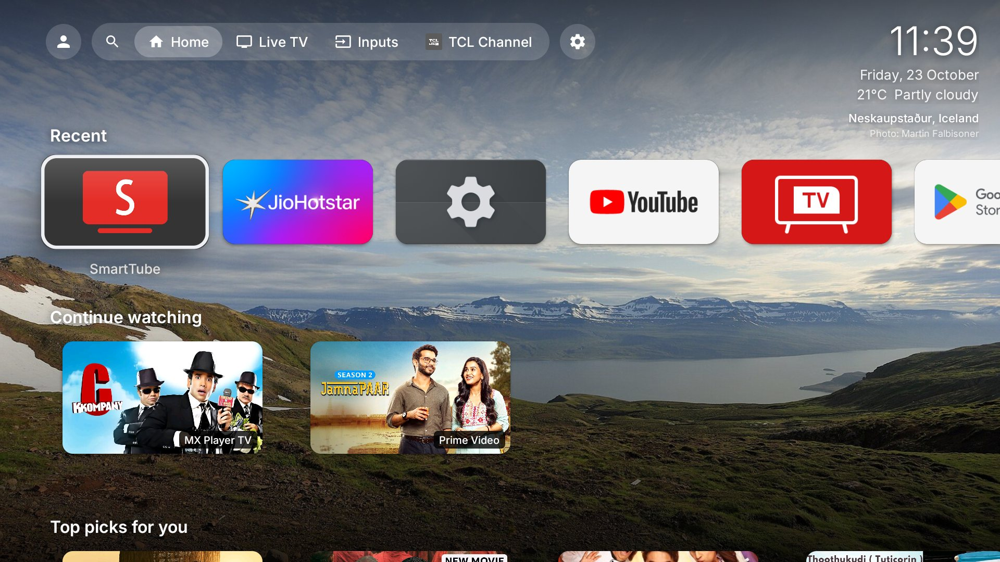
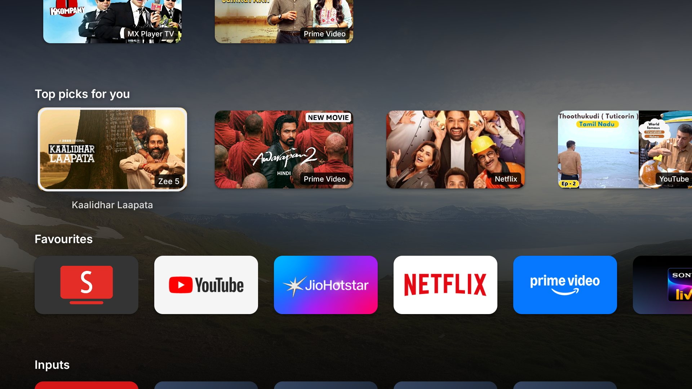
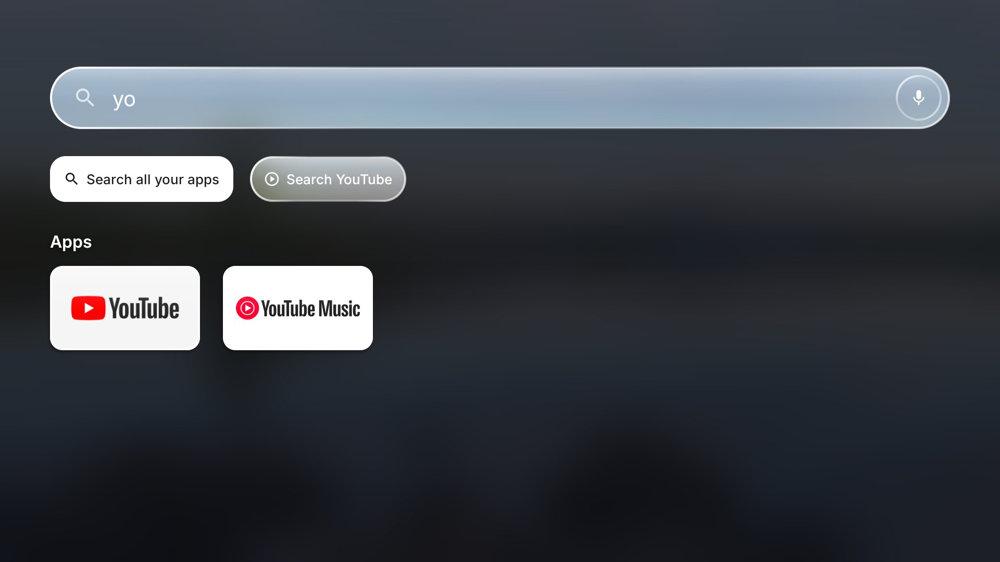
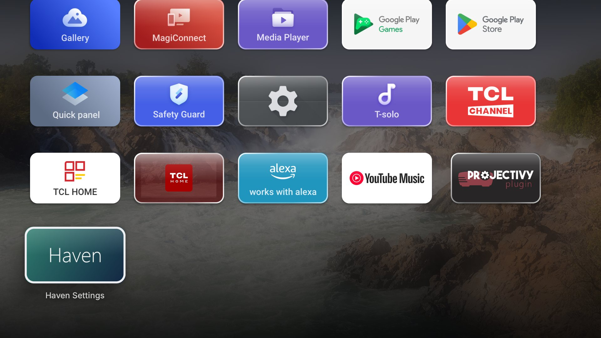
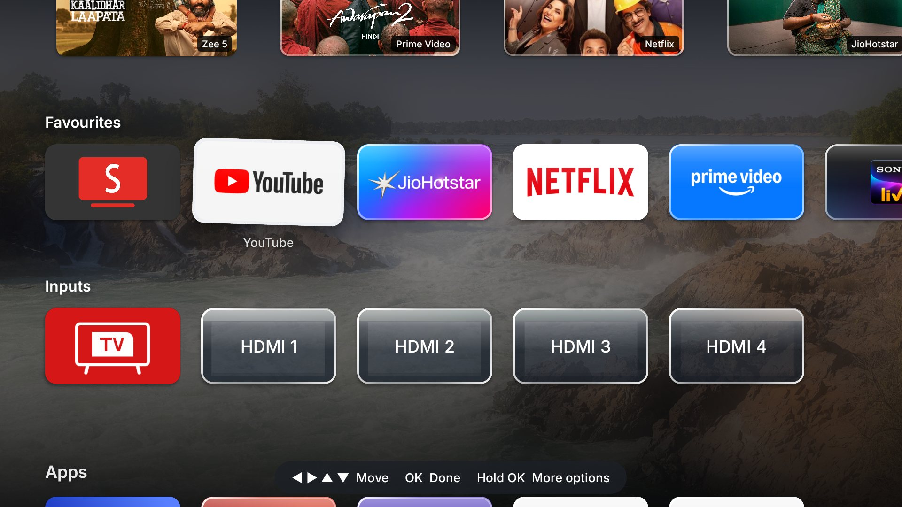
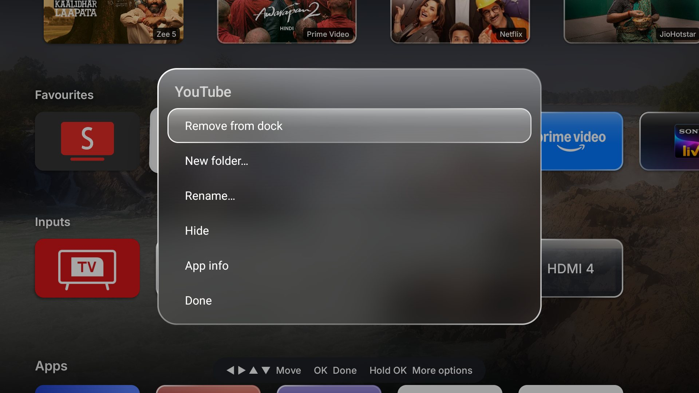
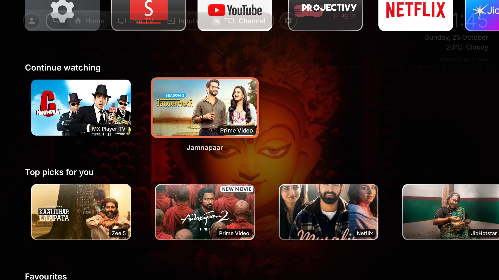
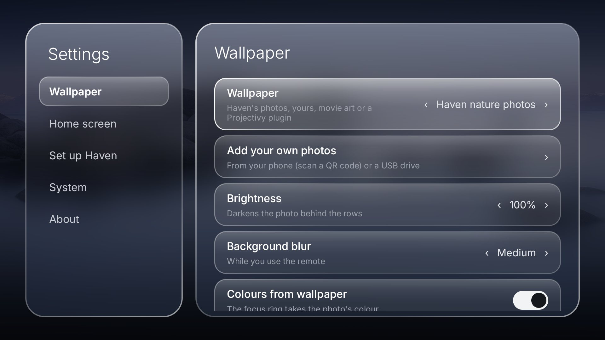
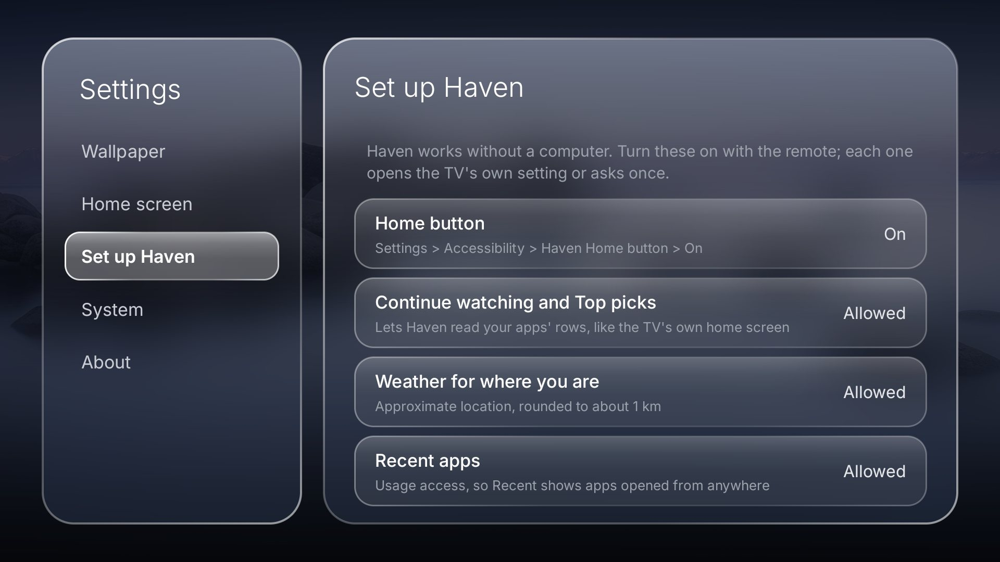

# Haven

A fast, minimal home screen for Google TV and Android TV, in the spirit of Apple TV: a clean row
layout, a dock of your favourite apps and full-screen nature photos that rotate in the background.

No ads, no tracking, no account, no root. Written in plain Java with no libraries; the APK is
mostly wallpapers.



| | |
|---|---|
|  |  |
| *Continue watching, Top picks, Favourites* | *Search: apps as you type, plus Google and YouTube search* |
|  |  |
| *All apps* | *Edit mode: hold OK, then move tiles with the arrows* |
|  |  |
| *Tile options: dock, folders, rename, hide* | *A Projectivy wallpaper plugin (Photo of the Day)* |
|  |  |
| *Haven Settings* | *Set up Haven: everything from the remote, no computer* |

## Features

- **Home rows**, top to bottom:
  - **Recent**: your recently used apps.
  - **Continue watching**: the Watch Next rows your apps publish, newest first.
  - **Top picks for you**: a few programs from each app's home-screen channels, mixed so no
    single app takes over, plus what's trending on Netflix in your country.
  - **Favourites**: the dock.
  - **Inputs**: Live TV and HDMI.
  - **Apps**: every app, which you can sort, put in folders, rename or hide.
- **Top bar** (press Up): account, search, Home, Live TV and the maker's channels app when the
  TV has them, Inputs and TV Settings.
- **Search**: a full-screen search bar that finds apps as you type, with "Search all your apps"
  (Google's search) and "Search YouTube". The mic works like the remote's mic button.
- **Wallpapers**: 26 Wikimedia Commons featured photos, with the place and photographer shown
  in the corner. The photo blurs while you use the remote and turns sharp again when you stop.
  The focus colour comes from the photo.
- **Movie & show art**: a wallpaper made from the artwork of your Continue watching and Top picks
  rows, with no API key needed. When you move to a card, the wallpaper changes to that title.
- **Your own photos**, added without adb: scan a QR code on the TV with your phone and pick
  photos, or copy them from a USB drive. Show them with Haven's photos or on their own.
- **Wallpaper plugins**: Haven works with Projectivy Launcher's wallpaper plugins, such as
  Bing photo of the day, Apple aerials, movie and show art (TMDB), Immich, Jellyfin and more.
  Install a plugin, then choose it in Haven Settings > Wallpaper. Its settings open from Haven
  Settings too. Still images, drawables and colours are supported; video and Lottie wallpapers
  aren't yet. Plugins that react to the focused card or to idle mode receive those events.
- **Clock, date and weather** for wherever the TV is (Open-Meteo; °F in the US).
- **Edit mode**: hold OK until the tiles wiggle, then move apps between the dock and the grid,
  make folders, rename or hide apps.
- **Screensaver**: "Haven nature photos" uses the same wallpapers.
- **Home button**: an accessibility service opens Haven straight away when you press Home, with no
  flash of the stock launcher. Google TV doesn't let a third-party launcher take over Home any
  other way.
- **Survives "cleaner" apps** (e.g. TCL's Safety Guard): it keeps a backup of your layout, starts
  its Home-button service again if something switches it off, and gets past boot managers that
  block third-party apps from starting at boot.
- **Glass look**, inspired by Apple's Liquid Glass: the top bar, tiles, cards, Settings and menus get a
  frosted fill that shows the blurred wallpaper behind, a light-catching rim and a soft sheen.
- **Settings** in two panels (sections on the left, options on the right). Left/Right changes a
  value in place.
- **Updates itself**: Haven checks GitHub for new versions and installs them when you say so.
  Android asks you to confirm each one; nothing installs silently.
- Up/Down moves exactly one row and Left/Right stays inside the row, so the remote never jumps
  somewhere unexpected.

## Install

### Without a computer

1. On the TV, install **Downloader** (by AFTVnews) from the Play Store.
2. Open Downloader and enter this address:
   `https://github.com/joydeepsjce/haven-tv/releases/latest/download/haven.apk`
3. When Android asks, allow Downloader to install apps, then press **Install**.
4. Open **Haven** from your apps. It opens **Set up Haven**. Turn on each item with the remote:
   - **Home button**: opens Settings > Accessibility. Choose *Haven Home button* and turn it on.
   - **Continue watching and Top picks**, and **Weather**: Android asks once. Choose Allow.
   - **Recent apps**: opens Usage access. Choose Haven and allow it.
   - **Install updates**: lets Haven install its own updates. You confirm each one.
5. Press Home.

If Android says the Home-button setting is restricted (some TVs do this for apps that didn't
come from the Play Store), go to Settings > Apps > Haven, allow restricted settings, and try
again.

**Updating:** Haven Settings > About > Check for updates. Haven also checks by itself every
12 hours and tells you when there's a new version.

### With a computer (optional extras)

A one-time adb setup adds two things the remote can't: Haven turns its Home-button service back
on if a "cleaner" app (such as TCL's Safety Guard) switches it off, and system animations run
twice as fast. It also does everything in Set up Haven in one go.

1. On the TV, turn on **Developer options**: Settings > System > About, then press OK on
   *Android TV OS build* seven times. Then turn on **USB debugging** and **Network debugging**
   under Settings > System > Developer options. Note the TV's IP address (Settings > Network).
2. Run the setup script from this repo. Include `haven.apk` to install or update Haven too.
   The first time, the TV asks you to allow debugging from your computer.

   ```sh
   sh setup.sh 192.168.1.50 haven.apk
   ```
   On Windows:
   ```powershell
   powershell -ExecutionPolicy Bypass -File setup.ps1 -Tv 192.168.1.50 -Apk haven.apk
   ```

Turn off Network debugging afterwards if you like; Haven doesn't need it.

**Remove:** Haven Settings > System > **Uninstall Haven**. Haven first undoes what it changed
outside itself (its layout backup, the animation speed, its Home-button service), then Android
asks you to confirm. If you cancel, Haven puts everything back. From a computer:
`sh setup.sh <ip> --remove` (`setup.ps1 -Tv <ip> -Remove`).

## Permissions

| Permission | Why |
|---|---|
| Accessibility service "Haven Home button" | Opens Haven when you press Home. It only listens for the Home key and for the Google TV home screen opening. It can't read what's on screen and logs nothing. |
| `READ_TV_LISTINGS` | Reads the Continue watching and channel rows your apps publish, as the stock launcher does. |
| `WRITE_SECURE_SETTINGS` (computer setup only) | Starts the Home-button service again if something turns it off, sets animation speed to 0.5×, and keeps a backup of the layout (which apps are where, nothing personal). |
| Usage access | Lists recent apps in the Recent row, including ones not opened from Haven. Optional. |
| `ACCESS_COARSE_LOCATION` | Gets the weather for where you are. Rounded to about 1 km and stored only on the TV. Optional. |
| `INTERNET` | Weather (api.open-meteo.com), Netflix trending titles (JustWatch's public API), images for wallpaper plugins, and the photo-upload page, which only runs on your network while its window is open. Nothing is sent anywhere else. |
| Photos (`READ_MEDIA_IMAGES`) | Only to copy photos from a USB drive when you ask. Optional; the TV asks the first time. |
| Uninstall (`REQUEST_DELETE_PACKAGES`) | Only for Settings > System > Uninstall Haven, which opens Android's own uninstall confirmation for Haven. |
| Install apps (`REQUEST_INSTALL_PACKAGES`) | Installs Haven's own updates from GitHub, after checking each one is Haven, newer, and signed with the same key. Android asks you to confirm every update. |

## Tips

- **Wallpaper plugins:** install a Projectivy wallpaper plugin APK, for example
  [Photo of the Day](https://github.com/spocky/projectivy-plugin-wallpaper-bingwallpaper/releases),
  with Downloader or `adb install`. Then Haven Settings > Wallpaper, and use Left/Right to pick it.

- **Your own wallpapers:** Haven Settings > Add your own photos.
  - *From your phone:* scan the QR code on the TV with your phone's camera (same Wi-Fi) and
    choose photos. The page only works while that window is open on the TV, and only with its
    4-digit code. The address is shown small under the code if your phone can't scan it.
  - *From a USB drive:* Haven copies JPG, PNG and WebP photos from the drive's folders (up to
    100 at a time). The first time, the TV asks to allow access to photos.
  - adb still works too: `adb push photo.jpg /sdcard/Android/data/home.haven.tv/files/wallpapers/`
  - Choose Wallpaper > My photos to see only yours. "Delete your photos" removes them.
- **Haven Settings** is the last tile in Apps: Wallpaper, Home screen, Set up Haven, System and
  About. Back returns to the section list, then closes.
- **Screensaver:** Settings > System > Ambient mode > Screensaver > Haven nature photos.
- Keys sent over adb skip the accessibility service, so `adb shell input keyevent HOME` still
  shows the stock launcher briefly. The real remote doesn't.

## Build

There's no Gradle, only the SDK's command-line tools. You need JDK 11 or later, plus Android SDK
build-tools and `platforms;android-34`.

```sh
ANDROID_HOME=/path/to/android-sdk sh build.sh
```

The output is `build/haven.apk`. Builds on Linux, macOS and Windows (Git Bash). The first build
creates your own signing key, `haven.keystore`. Keep it: updates must be signed with the same key,
and reinstalling loses the adb-granted permissions. Set `KS_PASS` to choose its password.

## Tested on

TCL Google TV (Android 14). The code checks for each feature before using it, so it should work
on other Google TV and Android TV devices (Android 8+), but they haven't been tested.
Reports are welcome.

## Notes

- Netflix doesn't publish its rows to the TV, so its titles come from
  [JustWatch](https://www.justwatch.com)'s unofficial public API and open in Google's search for
  that title. If JustWatch changes its API, they simply stop appearing.
- Haven isn't affiliated with Apple, Google, TCL or any streaming service.

## Licence

The code is under the MIT licence ([LICENSE](LICENSE)). The photos and the Inter font have their
own licences, listed in [NOTICE.md](NOTICE.md).
